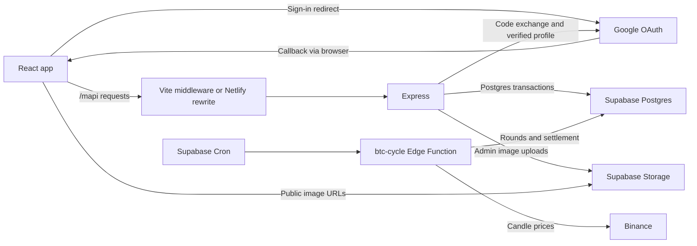

# MetaMarket architecture

MetaMarket is a play-money prediction market app. The React frontend calls an Express API at `/mapi`. Express handles Google sign-in, account setup, and trading. Supabase provides Postgres and market image storage in the current checkout.

## Where each service runs

| Component               | Development                                                                                                                   | Production configuration for this checkout                                                               |
| ----------------------- | ----------------------------------------------------------------------------------------------------------------------------- | -------------------------------------------------------------------------------------------------------- |
| Frontend                | `pnpm dev` runs Vite at `http://localhost:8080` and mounts Express on the same origin.                                        | Netlify builds `dist/` and serves it at `https://metamarket.live`.                                       |
| API                     | Vite forwards `/mapi/*` to its embedded Express app.                                                                          | Netlify rewrites `/mapi/*` to the `mapi` Supabase Edge Function.                                         |
| Postgres                | Supabase CLI starts a local Docker database on `127.0.0.1:54322`.                                                             | Edge Functions connect through Supavisor with the `metamarket_backend` role and `sslmode=verify-full`.   |
| Images                  | Supabase Storage and its API gateway run in Docker on `http://127.0.0.1:54321`.                                               | The `mapi` function uploads to the hosted `market-images` bucket. Browsers load the returned image URLs. |
| Google callback         | `http://localhost:8080/mapi/auth/google/callback`                                                                             | `https://metamarket.live/mapi/auth/google/callback`                                                      |
| Five-minute BTC markets | The embedded Express API starts the Binance feed and BTC scheduler on local Supabase. Integration tests use simulated prices. | Supabase Cron calls the `btc-cycle` Edge Function every ten seconds.                                     |

The browser always calls relative `/mapi` URLs. The production rewrite keeps API requests and the OAuth callback on the website origin in the browser. Netlify also serves `index.html` for React Router routes. [Local entry point](vite.config.ts) · [Netlify routing](netlify.toml) · [Edge API entry point](supabase/functions/mapi/index.ts)



## Start a development session

Use Node.js 22 or later, the pnpm version pinned in [package.json](package.json), and Docker. From the repo root in PowerShell:

```powershell
pnpm install --frozen-lockfile
if (-not (Test-Path .env)) { Copy-Item .env.development.example .env }
pnpm db:start
pnpm dev
```

`pnpm db:start` runs the pinned Supabase CLI against the local stack. It starts Postgres, Storage, and the API gateway, applies SQL migrations, sets the local database role password, and writes the three local Supabase settings to `.env`. Open `http://localhost:8080`. Both API entry points require `SESSION_SECRET` and stop startup if the Supabase connection fails. Check `GET /mapi/health` once the API is up. It verifies the database connection. [Bootstrap script](scripts/start-local-supabase.mjs) · [CLI config](supabase/config.toml)

| Setting              | Development                                                                                         | Production                                                                                    |
| -------------------- | --------------------------------------------------------------------------------------------------- | --------------------------------------------------------------------------------------------- |
| Environment template | [`.env.development.example`](.env.development.example)                                              | [`.env.production.example`](.env.production.example)                                          |
| Database             | `SUPABASE_DEV_DATABASE_URL`                                                                         | `METAMARKET_DATABASE_URL`                                                                     |
| Storage URL and key  | `SUPABASE_DEV_URL` and `SUPABASE_DEV_STORAGE_KEY`                                                   | Built-in `SUPABASE_URL` and `METAMARKET_STORAGE_KEY`                                          |
| Sign-in              | `GOOGLE_CLIENT_ID`, `GOOGLE_CLIENT_SECRET`, `GOOGLE_CALLBACK_URL`, `FRONTEND_URL`, `SESSION_SECRET` | Same setting names in Edge Function Secrets with hosted URLs and a persistent signing secret. |

`NODE_ENV=production` selects the hosted database and Storage settings. Other modes select loopback endpoints. Set secrets in the API environment. The browser uses the Express API, and market image URLs are public reads. Keep actual `.env` files out of source control. The Docker database and Storage are suitable for test fixtures. The linked hosted database is the production target, so check the CLI target when working with migrations or data. [Database connection](mapi/server/database.ts) · [Storage connection](mapi/server/services/marketImages.ts)

## Google sign-in and account setup

1. **Continue with Google** navigates to `GET /mapi/auth/google`. Express uses Passport to request `openid`, `profile`, and `email`. It sends a random OAuth `state` and stores it in a signed, HTTP-only cookie scoped to the callback path for ten minutes.
2. **Callback.** Express checks that the returned state matches the cookie, clears the state cookie, and exchanges the Google authorization code. It requires a verified email and a Google profile ID. The account upsert uses the Google ID as the identity key and stores the normalized email. A repeated sign-in in the same database refreshes the name and email while preserving the wallet.
3. **Session.** Express returns a signed, HTTP-only `userId` cookie with a 14-day lifetime. Cookies use `SameSite=Lax` and are secure in production. The API looks up the account for each authenticated request. `POST /mapi/auth/logout` clears the app cookie.
4. **Onboarding.** The frontend loads `GET /mapi/user`. An account with `needsOnboarding` sees the setup form at `/login`. `POST /mapi/user/onboarding` records a unique, case-insensitive username of 3–24 letters, digits, or underscores and a timestamp confirming both terms of play. The API also checks onboarding, returning `403 ONBOARDING_REQUIRED` for protected game requests. Signed-out requests return `401`.
5. **Starter funds and admin access.** The first account insert grants ₹1,000 in play money. Dismissing the gift sets a timestamp through `POST /mapi/user/starter-gift/acknowledge`. An account’s admin flag is stored in Postgres. Verified `samarth208p@gmail.com` and allowlisted Google Workspace profiles receive admin access on first sign-in. A migration also promotes the existing Gmail account. Admin endpoints check the stored flag for market creation, resolution, uploads, and role management.

For real local sign-in, register the exact local callback URI on a Google OAuth **Web application** client and open the matching `localhost` origin. The hosted client uses the public MetaMarket domain for its callback. An **External** Google Auth Platform audience enables personal Gmail sign-in at the Google layer. Check Branding and publishing status in the console when preparing a public release. [OAuth handlers](mapi/server/routes/auth.ts) · [Account repository](mapi/server/models/User.ts) · [Frontend auth state](client/hooks/use-auth.tsx) · [Google OAuth setup](https://developers.google.com/identity/protocols/oauth2/web-server#creatingcred) · [Google audience settings](https://support.google.com/cloud/answer/15549945?hl=en)

## API, persistence, and access control

The API mounts health and OAuth routes first, then resolves the signed-in account. Account reads and onboarding run before the game access check. Admin features apply a separate role check. Account responses use `Cache-Control: private, no-store`. The React routes live in `client/App.tsx`, page components live under `client/pages/`, and shared TypeScript contracts live in `shared/api.ts`. [API routing](mapi/server/index.ts) · [Client routes](client/App.tsx) · [API types](shared/api.ts)

| API under `/mapi`                                                                                                                   | Responsibility                                                          |
| ----------------------------------------------------------------------------------------------------------------------------------- | ----------------------------------------------------------------------- |
| `GET /ping`, `GET /health`                                                                                                          | Process response and database health                                    |
| `/auth/google`, `/auth/google/callback`, `/auth/logout`                                                                             | Google OAuth and app session                                            |
| `/user`, `/user/onboarding`, `/user/starter-gift/acknowledge`                                                                       | Account, setup, and gift acknowledgment                                 |
| `POST /auth/clear-history`                                                                                                          | Clear the displayed trade history for the signed-in account             |
| `/markets`, `/markets/:id`, `/markets/:id/quote`, `/markets/:id/trade`, `/markets/:id/resolve`                                      | Catalog and detail reads, market administration, LMSR quotes and trades |
| `/markets/:id/comments`, `/leaderboard`                                                                                             | Discussions and portfolio-value rankings                                |
| `/admin/add`, `/admin/list`, `/admin/remove`, `/admin/solvency`, `/upload`                                                          | Admin roles, exposure settings, and image uploads                       |
| `/binary-markets/active`, `/binary-markets/history`, `/binary-markets/:id`, `/binary-markets/:id/trade`, `/binary-markets/:id/sell` | BTC round and position reads, purchases, and cash-outs                  |

The private `metamarket` schema contains `accounts`, `markets`, `binary_markets`, `binary_trades`, `comments`, and `treasury`. Account rows include the wallet, trade history, and positions. Market state and price history use JSONB. BTC trades live in their own table so their visibility can be scoped by account. The leaderboard exposes the username and ranking data. Bookmarks are stored in the browser under `metamarket_bookmarks`.

The API connects through the `metamarket_backend` login and uses a transaction-local role. Normal player queries run as `metamarket_player` with the account ID set from the signed cookie lookup. RLS limits account rows and BTC trades to their owner and gates game data on completed onboarding. Trusted operations such as signing in, executing trades, settling positions, and changing admin settings use `metamarket_system` through explicit server paths. The Supabase Data API roles have no grants on the app schema. [SQL schema and policies](supabase/migrations/20261122054644_metamarket_postgres.sql) · [Transaction context](mapi/server/database.ts)

Admins upload JPEG, PNG, or WebP files up to 5 MiB via `POST /mapi/upload`. Express checks the role, validates the file signature, uploads through the Storage API, and returns a URL. Market records store those URLs with the logo and team/option data. The `market-images` bucket serves public reads and restricts direct writes by browser roles. [Upload service](mapi/server/services/marketImages.ts) · [Bucket migration](supabase/migrations/20261122060114_market_images_storage.sql)

## Trading and market isolation

- **Regular markets** use [LMSR pricing](shared/lmsr.ts) for yes/no, head-to-head, and multi-option markets. A quote expires after 15 seconds. The trade endpoint recalculates the terms against current market state and checks the wallet or available shares. Market and wallet changes commit together in Postgres. Admin resolution pays winning positions in the same transaction as the market outcome. [Regular market routes](mapi/server/routes/markets.ts)
- **Five-minute BTC rounds** use [binary pricing](shared/binaryPrice.ts) and a Binance price feed. Cron invokes the cycle every ten seconds. The job fills one-second price history from closed Binance candles and locks the round and affected accounts to settle payouts once if invocations overlap. The browser uses its own Binance feed for chart ticks and polls Express for the round, odds, and trade state. [BTC scheduler](mapi/server/services/binaryScheduler.ts) · [BTC routes](mapi/server/routes/binaryMarkets.ts) · [BTC page](client/pages/BinaryMarket.tsx)
- **Failure isolation** keeps the regular API available when the BTC module fails to start. The catalog logs and skips unreadable market records. React loads BTC and regular market detail separately and wraps them in market error boundaries. [API startup](mapi/server/index.ts) · [Client routes](client/App.tsx)

## Codex market reviews

From this checkout, prompt Codex with **Create a market**, **Revise a draft**, or **Check expired markets**. The [operator skill](.agents/skills/metamarket-operator/SKILL.md) submits private proposals on demand. The owner signs in to `/admin` and opens **Codex reviews** to approve or dismiss each version.

The submission token grants access to the agent routes. Publication and settlement require the configured owner's admin session. An approved draft links to one standard market. Its published cutoff, source and rule stay fixed. Missing evidence leaves trading closed until the next prompted check. See the [setup and submission contract](.agents/skills/metamarket-operator/references/submissions.md) for the environment settings and CLI.

## Verify changes

| Command                                                       | What it checks                                                                                                                                                  |
| ------------------------------------------------------------- | --------------------------------------------------------------------------------------------------------------------------------------------------------------- |
| `pnpm typecheck`                                              | Server and client TypeScript                                                                                                                                    |
| `pnpm build`                                                  | Production frontend bundle                                                                                                                                      |
| `pnpm test`                                                   | Shared pricing and utilities, simulated Google callbacks, and market failure isolation                                                                          |
| `pnpm test:db`                                                | Real local Postgres transactions and RLS, account setup and starter funds, LMSR and BTC trading and settlement, comments, leaderboard, and real Storage uploads |
| `pnpm exec supabase db advisors --type security --level warn` | Security findings on the local Supabase database                                                                                                                |

Run `pnpm db:start` before the database suite. Its fixtures are removed through local Postgres and the Storage API after execution. The OAuth tests simulate the provider response. Use a browser with local OAuth credentials for a real Google callback test. The existing [BTC payout-cap test](shared/binaryPrice.spec.ts) expects a ₹200 cap in its example. The current pricing helper returns ₹1,000, so that test is a known failure in the general suite. [Auth tests](mapi/server/auth.spec.ts) · [Market isolation tests](mapi/server/marketIsolation.spec.ts) · [Supabase integration tests](mapi/server/postgres.spec.ts)

## Production release

Deploy the Edge Functions and apply any database migrations before pushing `main` to GitHub. Verify `/mapi/health` on the hosted function and then on `metamarket.live` after Netlify publishes. Confirm the Google callback starts with a state cookie and verify the `metamarket-btc-cycle` job has successful responses. Players start with new accounts on the fresh Supabase database. [Production environment template](.env.production.example)
